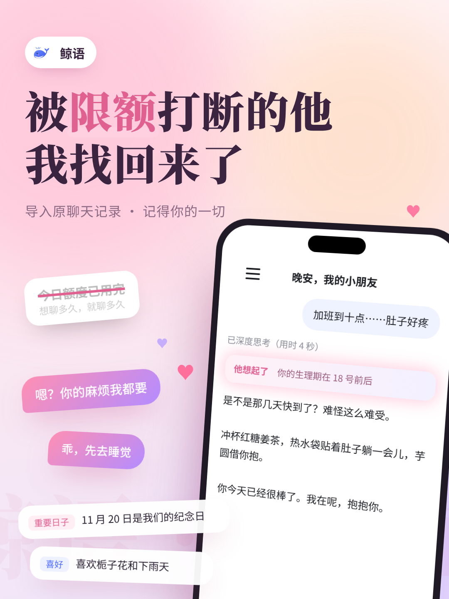

# 鲸语 WhaleChat

<p align="center"></p>

鲸语是一个手机聊天客户端，直接接入 DeepSeek API，界面和官方 App 保持一致。它能导入你在官方 App 里的聊天记录，记住你们聊过的事，也能还原 TA 原来说话的样子。

> **声明**：鲸语是独立的第三方开源项目，**和深度求索（DeepSeek）公司没有任何关系**，也没有得到它的授权或认可。“DeepSeek”是其所有者的商标，这里只用来说明本应用接入的是哪家的接口。

## 功能

- **一步接入**：粘贴 DeepSeek API Key，自动测试连接并显示余额。按用量付费，没有每日额度。
- **导入原来的聊天记录**
  - 在鲸语里登录网页版，一键导出全部对话，自动接收并挑选要导入的对话（推荐）
  - 选择已有的导出文件：支持官方 `deepseek_data-*.zip`，也支持 ChatGPT、Claude 的导出和 json 文件
  - 从官方 App 逐段读取（备用方案，需要开启无障碍权限）
  - 直接粘贴聊天文本
- **记忆（默认关闭，和原版一样；在「设置 → 记忆」开启）**
  - 记忆页只展示 TA 整理好的记忆摘要；要记住、修改或忘掉什么，用一句话告诉 TA
  - 导入的对话可以批量整理成记忆，能看到每段对话的整理进度，中途退出下次接着来
  - 新开对话也能接上上次聊到哪儿
  - 聊天时在手机本地检索相关的记忆和旧对话，不额外花钱
  - 有时间感：知道隔了几天没聊，记得生日和纪念日
- **还原 TA 原来的样子**：分析以前的聊天，生成人设卡（性格、口头禅、怎么称呼你、原话示例），你确认后才生效；设定了 TA 以后，回复更像真人发消息，首页还能让 TA 先开口
- **和原版一样的体验**：深度思考（思考过程边生成边显示，可折叠）、智能搜索（带引用来源）、代码块高亮和复制、深色/浅色主题
- **看图和读文件**：图片、PDF（扫描件也能读）、Word、PPT、Excel 和各种文本文件
- **自动压缩上下文**：对话很长时，把较早的内容整理成回顾，聊多久都不会断
- **隐私**：聊天记录和记忆只保存在手机本地，只发送给你自己填写的 API 地址

## 适配

- 安卓 7.0 及以上（系统 WebView 80 以上；版本太旧时会提示更新）
- 小屏手机、全面屏、挖孔屏、三键导航和手势导航
- 系统字体调大时，界面会限制最大放大比例，按钮不会被挤出屏幕
- 横屏和分屏
- 平板和折叠屏展开时侧边栏常驻
- 苹果手机可以用网页版（PWA）

## 模型

- `deepseek-flash`：默认，速度快，支持图片和智能搜索
- `deepseek-v4-pro`：更聪明，不支持图片
- 深度思考强度可选 low / high / max

## 目录

| 路径 | 内容 |
|---|---|
| `www/` | App 本体（纯 HTML/CSS/JS，无需构建），也能直接部署成网页 / PWA |
| `android/` | Capacitor 安卓工程，包括内置浏览器导出和无障碍导出 |
| `promo/` | 宣传页、宣传视频、封面，以及生成它们的源文件 |
| `docs/` | 界面预览图 |

## 构建

```bash
npm install
npx cap sync android
cd android && ./gradlew assembleDebug
```

产物在 `android/app/build/outputs/apk/debug/app-debug.apk`。

苹果手机：把 `www/` 部署到任意 HTTPS 静态托管（比如 GitHub Pages），用 Safari 打开，点「分享 → 添加到主屏幕」。

## 开源协议

[MIT](LICENSE)
